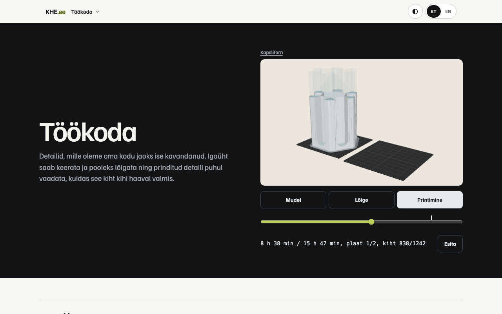

# khe-workshop

[](https://github.com/khelias/khe-workshop/actions/workflows/ci.yml)

The parts we design and 3D print for our own household, as source code, and
**Töökoda**, the room at [khe.ee/workshop](https://khe.ee/workshop/) that lets
a visitor turn each published part, cut it open and scrub through its real
print layer by layer.

[](https://khe.ee/workshop/)

## How it works

Each part is a parametric OpenSCAD file with a check that proves it: the mesh
is closed, it fits the printer, and where a part has to fit something else, the
fit is tested in the model. A part is published once it has been printed and
used, with its real print recorded; a part not printed yet may show in the room
as a labelled draft. khe-sites builds the room into khe.ee from a checkout of
this repo
([estate ADR-043](https://github.com/khelias/khe-architecture/blob/main/decisions/043-household-parts-are-public-source-built-into-khe-sites.md)).

## Run it

You need [OpenSCAD](https://openscad.org/downloads.html) (a recent snapshot),
Python 3 and Node.js.

```bash
python3 scripts/check.py
```

The check renders every part and runs its probes. It exits 0 on a pass, 1 on a
failure that names the part and 2 when OpenSCAD is missing.

## More

- [AGENTS.md](AGENTS.md) - commands, layout, and adding or publishing a part
- [docs/decisions/](docs/decisions/) - the repo's decisions

## Licence

The tools are under the [MIT licence](LICENSE). Each model has its own licence,
listed in [LICENSE-MODELS](LICENSE-MODELS). The U6-LR holder is non-commercial,
because its twist-lock is measured from another maker's model, and so is the star
egg, whose prints we sell.
